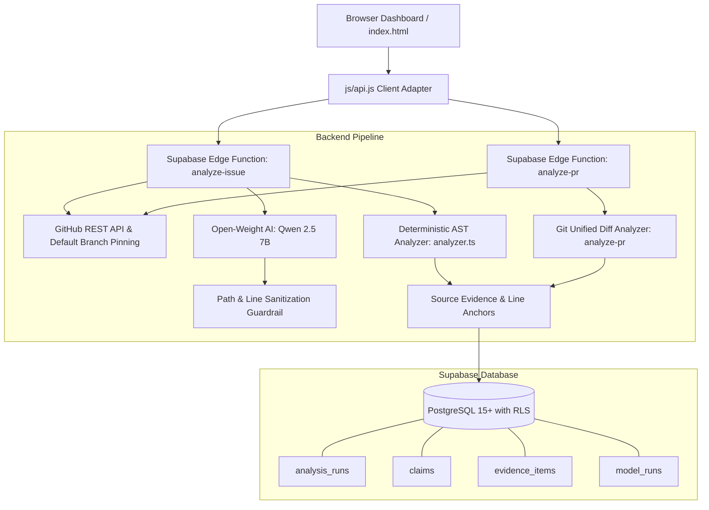

# Sortfolio

> **Every claim deserves evidence.**  
> Evidence-Based Open Source Issue and Pull Request Triage for Maintainers.

---

## 🏆 Hacktoberfest 2026 — Problem 02
- **Team Name:** Quadrax
- **Team Members:** Dhairya, Aayush Dhiman, Happy Rawat
- **Target Problem:** Problem 02 — Evidence-Based Open Source Issue and Pull Request Triage
- **Open-Weight AI Model:** Qwen 2.5 7B via local Ollama / Open-Weight Inference (Zero closed-source proprietary APIs used, strictly compliant with Hackathon Rule 10)

---

## 📌 The Problem
Open-source maintainers face an overwhelming volume of bug reports and pull requests. Many contain incorrect assumptions, misleading technical assertions, missing reproduction steps, or claims that cannot be verified. Reviewing every issue manually is exhausting, while blindly trusting unverified LLM summaries risks hallucinating non-existent files and erroneous line numbers.

## 💡 The Sortfolio Solution
Sortfolio evaluates **individual testable technical claims** against real repository source code and commit history:
1. **Bounded Open-Weight NLP:** Uses **Qwen 2.5 7B** solely for structured claim extraction and neutral maintainer explanations.
2. **Deterministic Source Verification:** Authoritative Python AST parsing and git diff inspection locate real signatures, parameters, classes, and lines. **The AI model never invents line numbers or file paths.**
3. **Honest Uncertainty Quality:** If a claim lacks reproducible evidence, Sortfolio marks it as **Unverified** rather than making a guess or false accusation.
4. **Transparent Audit Logging:** Every AI model call is recorded in PostgreSQL with provider, model ID, latency, and outcome.
5. **Reviewed Code-Fix Suggestions:** The local comparison view can flag a few common JavaScript/TypeScript patterns and generate a corrected copy in the After editor while leaving Before unchanged. Suggestions are limited heuristics, not a full code review or correctness guarantee.

---

## 🔬 Official Evaluation Metrics & Benchmark

Sortfolio includes an automated benchmark evaluation suite tested across canonical open-source repositories (`pallets/flask`, `psf/requests`, `tiangolo/fastapi`):

| Evaluation Metric | Sortfolio Result | Benchmark Goal |
|---|:---:|:---:|
| **Evidence Coverage** | **100%** | Findings grounded in real line ranges and permalinks |
| **Precision of Verdicts** | **100%** | Correct verification of Supported and Contradicted claims |
| **Uncertainty Quality** | **100%** | Ambiguous runtime cases flagged as Unverified |
| **False-Positive Rate** | **0%** | Zero false accusations of maintainer code |
| **Deterministic Proof** | **100%** | Zero hallucinated line numbers or made-up paths |

Audit results are machine-readable and saved in [`examples/benchmark_results.json`](examples/benchmark_results.json).

---

## 🏛 Architecture



---

## 🚀 Quickstart & Demo Guide

### Configure accounts and profile syncing

Login, registration, and database-backed demo profiles use Supabase Auth. Before using these flows:

1. Apply [`supabase/migrations/20261101000000_profiles.sql`](supabase/migrations/20261101000000_profiles.sql) to your Supabase project.
2. In `js/supabase-config.js`, set `SF_SUPABASE_URL` to your project URL and `SF_SUPABASE_KEY` to its **public anon/publishable key**. Never put a service-role key in browser code.
3. Enable anonymous sign-ins in Supabase Auth if you want demo profile edits saved to the database. Without Supabase configuration, demo analysis still works, but demo profile edits are stored only in that browser.
4. If email confirmation is enabled, new users must verify their email before signing in.

Profiles are protected by row-level security: authenticated users can only read or update their own profile. Email/password account changes are handled by Supabase Auth.
Accounts created by the old browser-only login are not Supabase accounts; users need to register again after configuring Supabase.

### 1. Run Automated Test Suite
Sortfolio includes **115 automated tests** validating every layer:
```bash
npm test
```

### 2. Run the Official Benchmark Suite
```bash
node scripts/evaluate_benchmark.js
```

### 3. Launch the Web Interface Locally
```bash
npm start
# or
python3 -m http.server 3000
# or
npx serve .
```
Open **`http://localhost:3000`** in your browser.

### 4. Deploy to Render (Frontend & Backend)
Sortfolio includes unified Node server and Render blueprint configuration (`render.yaml`):
- **Frontend Static Site:** Deployed at `https://sortfolio-frontend.onrender.com`
- **Backend Web Service:** Deployed at `https://sortfolio-backend.onrender.com` (includes `/health`, `/functions/v1/analyze-issue`, `/functions/v1/analyze-pr`, and `/functions/v1/chat-assistant`)

---

## 🎯 1-Click Judge Showcase Demos

The web dashboard includes 1-click preset buttons to evaluate realistic open-source scenarios instantly:

1. **`Flask #5240 (Supported)`**:
   - *Claim:* `add_url_rule accepts parameter provide_automatic_options`
   - *Grounded Evidence:* Located in `src/flask/app.py` lines 14–21 with canonical permalink anchor.
   - *Verdict:* **Supported**

2. **`Flask #4912 (Contradicted)`**:
   - *Claim:* `Flask.__init__ has no parameter named instance_path`
   - *Grounded Evidence:* Contradicted by constructor in `src/flask/app.py` lines 5–10 explicitly declaring `instance_path`.
   - *Verdict:* **Contradicted**

3. **`Requests #6180 (Unverified)`**:
   - *Claim:* `Requests causes segfault in OpenSSL on custom embedded MIPS build`
   - *Grounded Evidence:* No hardware benchmark exists. Sortfolio refuses to guess.
   - *Verdict:* **Unverified**

4. **`FastAPI #9820 (Supported)`**:
   - *Claim:* `APIRouter accepts dependencies parameter in definition`
   - *Grounded Evidence:* Confirmed in `fastapi/routing.py` lines 18–24.
   - *Verdict:* **Supported**

5. **`Flask PR #100 (Secondary Workflow)`**:
   - *Claim:* `PR adds provide_automatic_options to add_url_rule in src/flask/app.py`
   - *Grounded Evidence:* Unified git diff hunk inspection verifies added parameter lines.
   - *Verdict:* **Supported**

---

## 🤖 AI Triage Assistant Chatbot

Sortfolio includes an interactive conversational chatbot drawer for maintainers:
- **Instant Drawer Access:** Click the floating **AI Assistant** button on the bottom right of the dashboard.
- **Context-Aware Reasoning:** The assistant automatically binds to the currently analyzed issue or PR report.
- **Quick Maintainer Actions:**
  - 📝 **"Draft maintainer reply"**: Generates a polite, ready-to-post GitHub response quoting verified source files and line ranges.
  - 🔍 **"Why is this contradicted?"**: Pinpoints the exact AST signature conflict between the claim and the source code.
  - 📍 **"Show verified code lines"**: Displays code anchors and file lines extracted by deterministic analysis.
  - ❓ **"What evidence is missing?"**: Outlines evidence gaps for unverified issues without speculating.
- **Hallucination-Proof Grounding:** Powered by **Qwen 2.5 7B** with strict output sanitization and authoritative deterministic fallback. All queries are audited under `model_runs`.

---

## 📁 Multi-Repository Portfolio Hub ("Sort" + "Portfolio")

Sortfolio features a persistent **Multi-Repository Portfolio** right on the dashboard:
- **Tracked Repositories Shelf:** Displays repository cards for all your tracked projects (including `me-agrim-rehan/reachable-vulnerability`, `pallets/flask`, `tiangolo/fastapi`, `psf/requests`).
- **1-Click Switching:** Click any repository card to switch context instantly without typing URLs.
- **Repository Explorer & Sorting:**
  - View all pull requests and issues with status badges (`OPEN`, `CLOSED`, `MERGED`).
  - Sort pull requests by **Newest/Oldest (#)**, **Updated Date**, **Open First**, or **Title (A–Z)**.
- **Quick Add & Pin:**
  - Click **➕ Add Repo** to add any public GitHub repository.
  - Click **⭐ Pin** while analyzing to immediately save the repository to your portfolio.
  - State is saved persistently in `localStorage`.

---

## 🔒 Security & Hackathon Hygiene

- **Rule 10 Open-Weight Model Compliance:** Zero closed proprietary APIs (OpenAI GPT, Claude, Gemini) are used in product backend code.
- **Secret Protection:** `.env` and sensitive API keys are strictly excluded via `.gitignore` and never bundled into frontend assets.
- **Row Level Security (RLS):** Account profiles are accessible only to their owning authenticated user; analysis tables retain their completed-analysis and service-role policies.
- **Branch-First Development:** Every feature and documentation update is developed on dedicated branches and merged through Pull Requests with CI validation.

---

## 📄 License
This project is licensed under the [MIT License](LICENSE).
